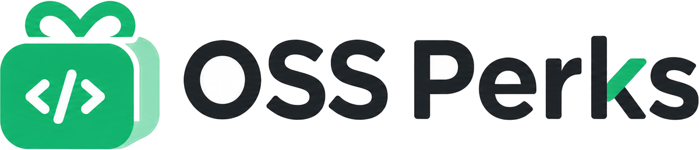

  <a href="https://opensource.3mi.ai">
    <picture>
      <source media="(prefers-color-scheme: dark)" srcset="public/brand/logo-wordmark-dark.png">
      
    </picture>
  </a>

<h3 align="center">開源福利社</h3>

  <strong>開源維護者可以免費拿到的工具與服務，一頁看完內容、條件、怎麼申請。</strong> 
  Free tools and services for open source maintainers — what you get, who qualifies, and how to apply, on one page.

  
  
  
  

  <a href="#繁體中文">繁體中文</a> · <a href="#简体中文">简体中文</a> · <a href="#english">English</a>

---
## 繁體中文

很多公司都有給開源專案的免費方案，但資訊散在各家官網。**[開源福利社](https://opensource.3mi.ai)** 把它們整理在同一頁：提供什麼、申請條件、門檻（直接開通／要申請／門檻高），每筆都附官方連結與最後驗證日期。可以依 [CNCF Landscape](https://landscape.cncf.io) 分類篩選，有繁中、简中、English 三種語言。

**要新增或修正方案，只要改一個檔案：** `data/programs/<id>.json`。複製一個現有檔案改內容、送 PR 就好，網站和其他檔案在合併後會自動更新。欄位說明見 [CONTRIBUTING.md](CONTRIBUTING.md)。

授權：程式碼 [MIT](./LICENSE)，方案資料（`data/`）[CC BY 4.0](./data/LICENSE)。

## 简体中文

很多公司都有面向开源项目的免费方案，但信息散落在各家官网。**[开源福利社](https://opensource.3mi.ai/zh-hans/)** 把它们整理在同一页：提供什么、申请条件、门槛（直接开通／要申请／门槛高），每条都附官方链接与最后验证日期。可以按 [CNCF Landscape](https://landscape.cncf.io) 分类筛选，支持繁中、简中、English 三种语言。

**要新增或修正方案，只需改一个文件：** `data/programs/<id>.json`。复制一个现有文件改内容、提交 PR 即可，网站和其他文件会在合并后自动更新。字段说明见 [CONTRIBUTING.md](CONTRIBUTING.md#简体中文)。

许可：代码 [MIT](./LICENSE)，方案数据（`data/`）[CC BY 4.0](./data/LICENSE)。

## English

Many companies offer free plans for open source projects, but the details are scattered across their websites. **[OSS Perks](https://opensource.3mi.ai/en/)** puts them on one page: what you get, who qualifies, and how hard it is to get (direct activation / application required / high bar), each with an official link and a last-verified date. Filter by [CNCF Landscape](https://landscape.cncf.io) category, in Traditional Chinese, Simplified Chinese or English.

**To add or fix a program, edit one file:** `data/programs/<id>.json`. Copy an existing file, change it, and open a PR; the site and everything else update automatically after merge. Field reference: [CONTRIBUTING.md](CONTRIBUTING.md#english).

License: code [MIT](./LICENSE), program data (`data/`) [CC BY 4.0](./data/LICENSE).
